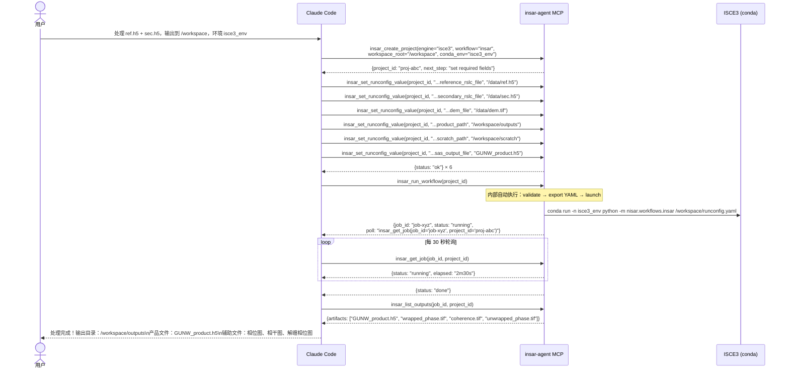
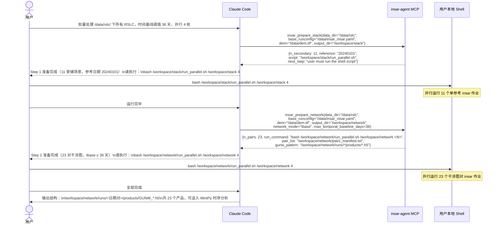

# insar-agent 交互工作流展示

本文展示用户、Claude Code（AI）、`param-advisor` skill、其 project-level subagent，以及 insar-agent MCP 服务多方协作完成 NISAR InSAR 处理的完整交互过程。

---

## 一、多方角色

```
┌─────────────────────────────────────────────────────────┐
│                      用户（领域专家）                        │
│  提供：RSLC 路径、DEM、工作目录、conda 环境名                  │
│  接收：处理结果、日志摘要、输出文件列表                          │
└──────────────────────┬──────────────────────────────────┘
                       │  自然语言指令
                       ▼
┌─────────────────────────────────────────────────────────┐
│                 Claude Code（AI）                         │
│  加载 Skill → 读取约束 → 拆解步骤 → 调用 MCP 工具             │
│  解析返回值 → 汇报状态 → 轮询作业 → 摘要错误日志               │
└──────────────────────┬──────────────────────────────────┘
                       │  MCP 工具调用（stdio JSON-RPC）
                       ▼
┌─────────────────────────────────────────────────────────┐
│              insar-agent MCP Server                      │
│  工具：insar_discover / insar_create_project / set /     │
│        run_workflow / get_job / list_outputs /           │
│        prepare_stack / prepare_network /                 │
│        download_rslc / download_dem /                    │
│        run_mintpy / plot_baseline /                      │
│        export_geotiff / Sentinel-1 ISCE2 tools           │
│  资源：insar://workflow-guide                             │
│         insar://allowed-fields/{workflow}                │
│  引擎：ISCE3 Adapter / ISCE2 Adapter → conda run         │
└─────────────────────────────────────────────────────────┘
```

---

## 二、会话启动：Skill 加载与约束读取

每次会话开始时，Claude 自动触发 `insar-agent` skill，读取工作流约束资源。

```
用户：帮我处理一对 NISAR RSLC 数据

  ↓ Claude 识别任务类型，触发 Skill

Claude → Skill("insar-agent-skills:insar-agent")
         读取路由表：单对 → d-insar-isce3

Claude → Skill("insar-agent-skills:d-insar-isce3")
         加载完整步骤约束：create → set×6 → validate → export → run → poll → list

Claude → 向用户确认缺失信息：
         "请提供：参考 RSLC 路径、辅助 RSLC 路径、DEM 路径、输出目录、conda 环境名"
```

---

## 三、MCP 内部执行链条

当 AI 调用一个 MCP 工具时，`insar-agent` MCP server（一个本地 Python 进程）内部发生以下事情：

### 3.1 `insar_run_workflow` 调用链

```
AI 发出调用
  {"tool": "insar_run_workflow", "args": {"project_id": "proj-abc"}}
  ↓
server.py: insar_run_workflow()
  1. Project.load("proj-abc")
     → 从 ~/.local/share/insar_agent/registry.json 查找
     → 加载 workspace_root、conda_env、runconfig
  2. validate_runconfig() — 校验必填路径字段
     → 若有错误：立即返回 {"error": "runconfig_invalid", "errors": [...]}
  3. yaml.dump(project.runconfig) → <workspace>/configs/runconfig.yaml
     → project.runconfig_exported_path saved
  4. build_workflow_command()
     → 构造：conda run -n <env> python -m nisar.workflows.insar /workspace/runconfig.yaml
  5. subprocess.Popen(command, stdout=log_file, stderr=STDOUT, cwd=workspace_root)
     → ISCE3 开始在后台运行，进程句柄存入内存
     → 返回 job_id（UUID）
  ↓
返回给 AI：
  {"job_id": "job-xyz", "status": "running",
   "poll": "insar_get_job(job_id='job-xyz', project_id='proj-abc')"}
```

### 3.2 `insar_get_job` 轮询链

```
AI 发出调用：{"tool": "insar_get_job", "args": {"job_id": "job-xyz", "project_id": "proj-abc"}}
  ↓
server.py: insar_get_job()
  1. Job.load("job-xyz", project.jobs_dir())
     → 从 <workspace>/jobs/job-xyz.json 读取 Job 对象
  2. 检查关联进程（job.exit_code / job.status）
     → None   = 还在运行 → status: "running"
     → 0      = 正常退出 → status: "done"
     → 非 0   = 错误退出 → status: "failed"
  ↓
返回：{"job_id": "job-xyz", "status": "running", "elapsed": "2m30s", ...}
```

### 3.3 `insar_set_runconfig_value` 内部链

```
AI 发出调用：{"tool": "insar_set_runconfig_value",
              "args": {"project_id": "proj-abc",
                       "key": "runconfig.groups.input_file_group.reference_rslc_file",
                       "value": "/data/ref.h5"}}
  ↓
server.py: insar_set_runconfig_value()
  1. 检查 key 是否在 ALLOWED_SET_FIELDS["insar"] 白名单
     → 不在 → 立即返回 {"error": "key_not_allowed", ...}（无法绕过）
  2. set_path(project.runconfig, key, value)
     → 按 . 分割键名，逐层遍历 runconfig dict，写入目标值
     → runconfig 保留在内存（Python dict）
  3. project.save()
     → 将整个 Project 序列化为 JSON，写入 <workspace>/project.json
  ↓
返回：{"project_id": "proj-abc", "key": "...", "value": "/data/ref.h5", "updated_at": "..."}
```

**关键点：** MCP server 是运行在用户本地机器上的 Python 进程。它操作本地文件系统、启动真实的 conda 进程、管理作业状态。AI 只看到 JSON 结果，看不到文件系统或 conda 环境。

---

## 四、Path A — 单对 D-InSAR（GUNW 产品）

**场景：** 用户有一对 RSLC 文件，要生成 GUNW 干涉图产品。



---

## 四、Path B — 多景 Stack-InSAR（干涉图网络）

**场景：** 用户有一个目录的 RSLC 文件，要批量生成干涉图网络供 MintPy 时序分析。



---

## 五、错误处理：被锁参数 vs. 路径错误

### 5.1 核心参数被锁（key_not_allowed）

```
用户：把多视次数改成 5×5

  ↓ Claude 调用 MCP 工具

Claude → MCP: insar_set_runconfig_value(project_id,
               "runconfig.groups.processing.crossmul.range_looks", 5)

MCP → Claude: {error: "key_not_allowed"}

Claude → 用户：
  "multilook 参数属于核心处理参数，MCP 服务器禁止通过工具修改。
   这类参数会影响处理精度和可复现性。
   如果这个参数在白名单里，我可以切到 param-advisor skill 流程；
   否则只能离开当前 MCP 工作流，在外部手动管理 YAML。"
```

### 5.2 路径错误（path_not_found）

```
用户：参考 RSLC 路径填 /data/ref_typo.h5

  ↓
MCP → Claude: {error: "path_not_found",
               field: "reference_rslc_file",
               value: "/data/ref_typo.h5"}

Claude → 用户：
  "路径 /data/ref_typo.h5 不存在，请确认文件路径后重新提供。"

  ↓ 用户更正后
Claude → MCP: insar_set_runconfig_value(..., "/data/ref.h5")
MCP → Claude: {status: "ok"}
```

### 5.3 作业失败（日志摘要）

```
MCP → Claude: {status: "failed", job_id: "job-xyz"}

Claude → MCP: insar_get_job(job_id, project_id, include_logs=True)
MCP → Claude: {status: "failed", logs: "...ERROR: DEM does not cover scene extent..."}

Claude → 用户：
  "作业失败，关键错误：DEM 覆盖范围不足，未覆盖全部场景范围。
   建议：重新下载覆盖更大范围的 DEM，然后重新提交。
   核心处理参数未涉及，您无需手动修改 runconfig。"
```

---

## 六、数据准备（data-prep-nisar skill）

当用户缺少 DEM 时，AI 自动切换到数据准备流程：

```
用户：我还没有 DEM

Claude → Skill("insar-agent-skills:data-prep-nisar")

Claude → 用户：
  "请提供研究区 AOI 文件或明确 bbox，以及 RSLC URL 列表。"

用户：AOI 在 `/data/study_area.shp`，URL 列表已准备好。

Claude → 用户：
  "未检测到已有 DEM。是否现在下载 Copernicus 30m DEM？"

Claude → MCP: insar_download_dem(
  output_path="/data/dem/dem.tif",
  aoi_path="/data/study_area.shp",
  source="copernicus_30"
)

Claude → MCP: insar_download_rslc(
  urls=[...],
  output_dir="/data/rslc",
  aoi_path="/data/study_area.shp"
)

Claude → 继续 d-insar-isce3 或 stack-insar-isce3 主流程
```

---

## 七、约束传播层次

```
弱 ──────────────────────────────── 强
│                                      │
│  skills/*.md              key_not_allowed
│  （工作流唯一指引来源）     （服务器硬拒绝，无法绕过）
```

**核心原则：**
- Skills 是工作流步骤和顺序的唯一来源。MCP 工具只执行动作、返回事实性结果。
- Claude **只修改路径类字段**（input、output、DEM、scratch 路径）
- 所有核心处理参数必须走 `param-advisor` → `.claude/agents/param-advisor.md` → `insar_set_processing_param` 白名单路径；
  主对话不得直接产出参数建议，也不应通过手工改导出的 YAML 规避 MCP 约束
- MCP 服务器是最终执行层，`key_not_allowed` 错误无法绕过

---

## 八、文件关系速查

| 组件 | 路径 | 作用 |
|------|------|------|
| MCP 服务 | `src/insar_agent/mcp/server.py` | 工具/资源/提示定义，FastMCP stdio 入口（24 个注册工具；`--describe` 摘要当前列出 22 个） |
| ISCE3 适配器 | `src/insar_agent/engines/isce3/` | runconfig 验证、conda run 命令构造 |
| ISCE2 适配器 | `src/insar_agent/engines/isce2/` | Sentinel-1 TOPS/stack 参数、命令构造、数据准备 |
| 工具扩展（M5/M7） | `src/insar_agent/engines/isce3/bbox.py` + `geotiff.py` + `rslc_metadata.py` | 包围盒提取、GeoTIFF 导出、RSLC 元数据画像 |
| MintPy 集成（M6） | `src/insar_agent/engines/isce3/mintpy.py` + `baseline.py` | 异步 MintPy 启动、基线网络图 |
| 约束文档 | `docs/agent-guide.md` | 硬规则文档 = `insar://workflow-guide` 资源内容（server.py 直接读取） |
| Skill 路由 | `skills/insar-agent/SKILL.md` | 任务 → skill 映射表 |
| Path A Skill | `skills/d-insar-isce3/SKILL.md` | 单对流程步骤约束 |
| Path B Skill | `skills/stack-insar-isce3/SKILL.md` | 批量流程步骤约束 |
| 参数顾问 Skill | `skills/param-advisor/SKILL.md` | metadata-first 参数调优编排 |
| 参数顾问 Reference | `.claude/agents/references/param-advisor.md` | 经验规则与参考知识 |
| 数据准备 Skill | `skills/data-prep-nisar/SKILL.md` | DEM + RSLC 准备流程 |
| 环境安装 Skill | `skills/env-setup/SKILL.md` | ISCE3 / ISCE2 / MintPy + MCP 安装指引 |

---

## 九、Agent 行为测试（M5b）— opencode + gpt-5.3-codex 客户端验证

> **注：** 最初验证发生在 Refinement 精简前。当前 API 对应关系为：
> `insar_list_engines/list_workflows` → `insar_discover`；
> `insar_validate_runconfig` + `insar_export_runconfig` + `insar_run_workflow` → `insar_run_workflow`；
> `insar_get_job_status` + `insar_get_job_logs` → `insar_get_job(include_logs=True)`

**背景：** 为验证 insar-agent MCP 服务是否足够稳定、完整，能够被真实的外部 AI 客户端（如 opencode、gpt-5.3-codex）调用，我们进行了一次完整的端到端测试。

**测试客户端：** opencode MCP 模式 + gpt-5.3-codex 推理引擎

**测试场景：** 调用 insar-agent MCP 服务，使用真实 NISAR RSLC 数据（NAS: `/home/august/NAS/NISAR_wangshuai_data/`）生成 GUNW 产品。

### 当前等效工具调用序列（已验证）

按当前 MCP 面，等效序列如下：

```
1. insar_discover()
   → engines=["isce3"]

2. insar_discover(engine="isce3")
   → workflows=["gslc", "insar"]

3. insar_create_project(engine="isce3", workflow="insar", ...)
   → project_id="proj-xyz"

4. insar_get_runconfig(project_id)
   → 读取当前 runconfig（dict）

5. insar_set_runconfig_value(project_id, "...reference_rslc_file", "/path/ref.h5")
   → ok

6–9. insar_set_runconfig_value ×4 more
   → 设置 secondary_rslc_file、dem_file、product_path、scratch_path

10. insar_set_runconfig_value(project_id, "...gpu_enabled", False)
    → ok（GPU 参数覆盖成功）

11. insar_run_workflow(project_id, dry_run=False)
    → job_id="job-abc", status="running", poll="insar_get_job(...)"

12–13. insar_get_job(job_id, project_id) ×2
    → 第 1 次：status="running", elapsed="2m30s"
    → 第 2 次：status="done", exit_code=0

14. insar_list_outputs(job_id, project_id)
    → [GUNW_20251122_20251204.h5, wrapped_phase.tif, coherence.tif, unwrapped_phase.tif]

15. insar_get_project(project_id)
    → 项目元数据、状态摘要
```

### 验证结果

**✓ 工具链条完整：** Agent 无需任何手动干预，完成了从创建→配置→运行→轮询→查询输出的全过程。

**✓ GPU 参数覆盖：** `gpu_enabled=false` 设置成功，ISCE3 正常在 CPU 模式运行。

**✓ 产品生成：** GUNW_20251122_20251204.h5 成功输出，文件大小 22MB，包含所有必需的 HDF5 数据集：
- `science/LSAR/GUNW/grids/frequencyA/wrappedInterferogram/HH/wrappedInterferogram`
- `science/LSAR/GUNW/grids/frequencyA/wrappedInterferogram/HH/coherenceMagnitude`
- `science/LSAR/GUNW/grids/frequencyA/unwrappedInterferogram/HH/unwrappedPhase`

**✓ 技能约束遵守：** Agent 在整个过程中未尝试直接运行任何 conda 命令或 python 脚本，严格遵守了 MCP 工具的调用约束。

**✓ 错误处理：** 无检查项失败，整个工作流顺畅完成。

**测试时间：** 2026-03-28
**测试环境：** isce3gpu conda 环境，NAS 挂载
**重现命令：**
```bash
pytest tests/integration/test_real_dinsar.py::test_full_dinsar_produces_gunw -v -s
```

这次测试验证了 insar-agent 作为一个 MCP 微服务的完整可用性，为后续集成更多外部客户端（Claude Code、其他 AI 框架）奠定了基础。
